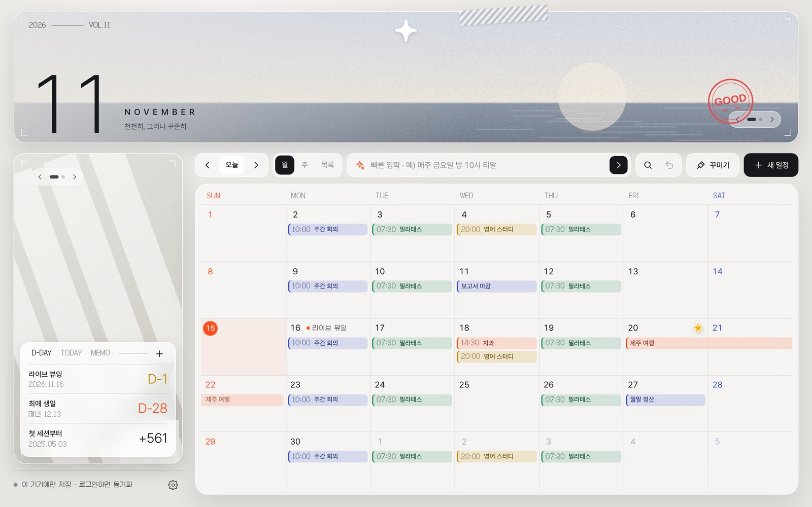
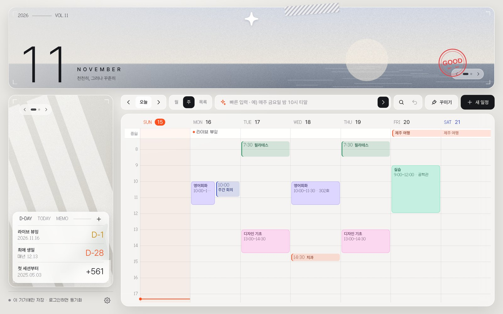
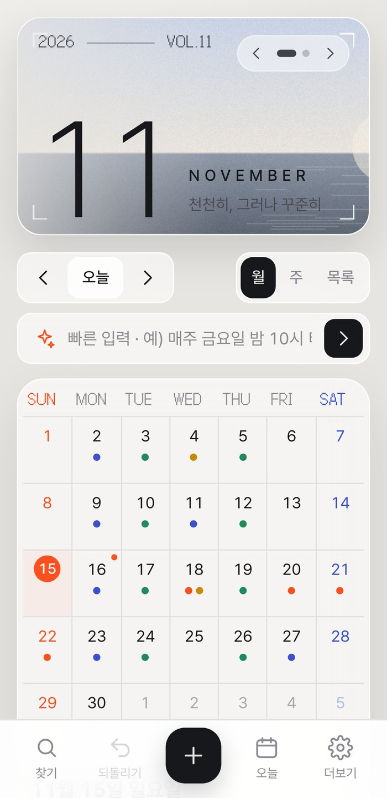

# 나비 캘린더

태블릿, 휴대폰, PC 어디서 고쳐도 같은 일정이 보이는 캘린더 앱입니다.

개인이 만든 설치형 캘린더 앱은 대부분 일정이 기기 안에만 저장돼서, 한 기기에 적은 일정이 다른 기기에서는 보이지 않았습니다. 그래서 로그인하면 모든 기기에서 일정이 맞춰지도록 직접 만들었습니다. 지금은 저와 친구들이 쓰고 있습니다.

## 바로 써 보기

| | |
| --- | --- |
| 웹 (설치 없이) | **https://nabi-calendar.pages.dev** |
| 윈도우 · 안드로이드 | [최신 버전 받기 (릴리스)](https://github.com/tmzkdlleaf-bit/nabi-calendar/releases/latest) |

로그인하지 않아도 예시 달력으로 바로 둘러볼 수 있습니다. 로그인하면 기기 간 동기화가 켜집니다.

## 화면

## 주요 기능

- 로그인 동기화 (Supabase) · 인터넷이 끊겨도 고칠 수 있고, 연결되면 알아서 올라감
- 월 · 주 · 목록 보기, 일정 찾기, 끌어서 날짜와 시간 옮기기, 되돌리기
- 빠른 입력: "매주 금요일 밤 10시 티알", "세시 반"처럼 한 줄로 일정 넣기
- 시간표: 사진을 올리면 과목 · 요일 · 시간 · 장소를 자동으로 채움 (에브리타임 캡처는 기기 안에서, 그 밖의 시간표는 AI가 읽음)
- 디데이, 메모, 스티커와 테마 꾸미기
- 웹(홈 화면 앱) · 윈도우 · 안드로이드 배포, 새 버전이 나오면 앱에서 알려 줌

## 업데이트 기록

| 버전 | 날짜 | 내용 |
| --- | --- | --- |
| 1.4.3 | 2026.10 | 보안 강화 · 남이 만든 백업 파일이나 로그인 링크로 달력이 위험해지지 않게 막음 |
| 1.4.2 | 2026.09 | 휴대폰 '오늘' 서랍이 바로 닫히던 문제 수정 |
| 1.4.1 | 2026.09 | 휴대폰 화면 새로 만듦 · 아래 메뉴, 색 점 월 보기, 3일씩 넘기는 주 보기 |
| 1.3.4 | 2026.09 | 안드로이드 새 버전을 받을 때 옛 버전이 받아져 설치가 안 되던 문제 수정 |
| 1.3.3 | 2026.09 | 구글 로그인이 준비되지 않았을 때 오류 화면이 뜨지 않게 함 |
| 1.3.2 | 2026.09 | 스티커 · 테이프가 다음 달에 사라지던 문제 수정 |
| 1.3.1 | 2026.09 | 알림이 설정 · 편집 창에 가려지던 문제 수정 |
| 1.3.0 | 2026.09 | 시간표 사진 자동 읽기 |
| 1.2.0 | 2026.09 | 시간표 · 주 보기에서 끌어서 시간 바꾸기 · 기념일 디데이 |
| 1.1.0 | 2026.09 | 월 · 주 · 목록 보기, 찾기, 되돌리기, 오프라인 편집, 알림, 빠른 입력 |
| 1.0.0 | 2026.09 | 첫 버전 |

## 만든 사람

기획, 디자인, 개발, 배포를 혼자 했습니다. JavaScript, Supabase, Cloudflare Pages를 씁니다.
